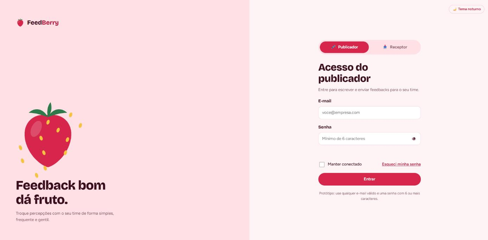
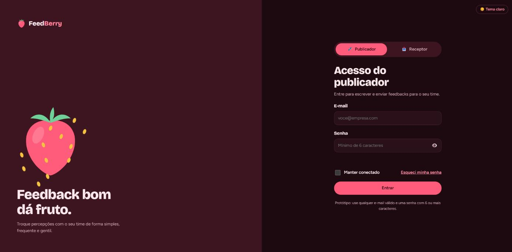
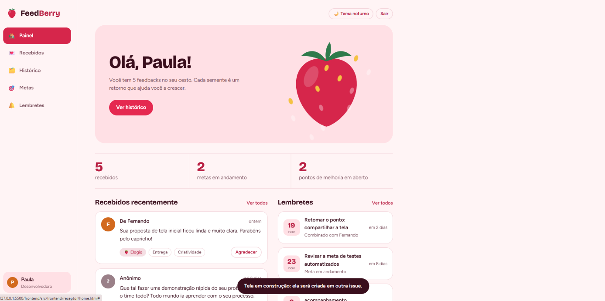
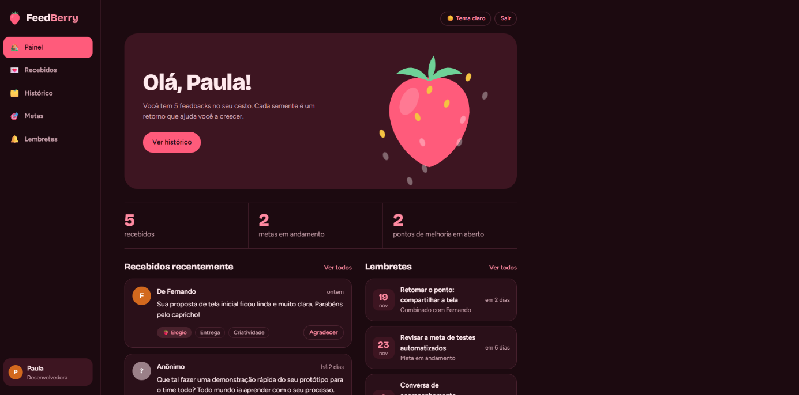

# Protótipos

Para validar a usabilidade (RNF01) e garantir uma interface responsiva (RNF05) e acessível (RNF06), foram desenvolvidos protótipos de alta fidelidade. A interface do FeedBerry foi projetada para oferecer uma experiência de navegação limpa, intuitiva e moderna, contando com suporte nativo para alternância entre os temas Claro (*Light Mode*) e Escuro (*Dark Mode*), respeitando as preferências de conforto visual do usuário.

## 1. Tela de Login (tema claro e escuro)

A tela de autenticação centraliza o acesso seguro ao sistema. Nela, o usuário insere suas credenciais (e-mail e senha). O layout foi desenhado para ser direto e acessível, com validações visuais de preenchimento.

## 2. Homepage (Visão Geral e Histórico)

A página inicial atua como o painel central (*dashboard*) do usuário. Para os colaboradores, exibe o histórico de feedbacks recentes, gráficos de evolução e metas ativas. Para os líderes, apresenta os atalhos para envio de novos feedbacks e agendamento de lembretes, além do acompanhamento da equipe.

